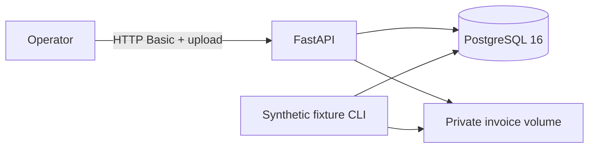

# Architecture and Day 1 decisions

FastAPI is a modular monolith. PostgreSQL owns application state. Private files
are stored under UUID names on a dedicated local directory/volume. The dashboard
and integrations will call the API; no integration will own business rules.

Day 1 implements ingestion and read APIs only. There is no extraction, approval,
or posting path yet. All accepted invoices stay `RECEIVED`, with revision 1.
Validation, review and ledger tables establish the schema for later milestones;
their presence does not imply those features work.

- Follow `PROJECT_SPEC.md` for the exact statuses and single demo operator.
  Users and line items do not need separate tables in this MVP: the local
  operator comes from environment variables, and line items belong to versioned
  JSON payloads. This resolves the broader examples in the supplied pasted brief.
  That brief is preserved in `IMPLEMENTATION_BRIEF.md`; its final instruction
  limits the current implementation to Day 1 and requires a results report before Day 2.
- SHA-256 is globally unique: uploading the same bytes from another source returns
  the existing invoice. A PostgreSQL transaction advisory lock serializes equal
  hashes; a unique constraint provides an independent database guard. Duplicate
  attempts append audit events. Business duplicates with different bytes are a
  separate Day 2 validation rule.
- Uploaded filename is display metadata only. Storage uses UUIDs, validates the
  path is under the configured root, and exposes files through an authenticated
  attachment response. No static upload directory is mounted publicly.
- Validate extension, declared MIME, actual signature, and parser acceptance.
  Reject encrypted PDFs, more than 100 PDF pages, and images over 25 megapixels.
  These are bounded demo limits, not a malware scanner. No remote URL ingestion.
- Reject files over 8 MiB. The ASGI middleware additionally caps the entire body
  at 8 MiB plus 64 KiB of multipart overhead, including chunked requests.
- File write and database insert are coordinated: normal transaction failures
  remove the newly written file. A process or host crash can leave an orphaned
  file; crash reconciliation is not implemented in Day 1. PostgreSQL is authoritative.
- Audits are append-only in API code and protected against UPDATE/DELETE by a
  database trigger. Database owners can still remove tables or triggers; this is
  not a claim of tamper-proof financial compliance.
- Startup refuses empty/default operator passwords; OpenAPI docs require auth.
  CORS permits the configured localhost frontend only. Basic auth is local-only;
  this milestone does not implement public portfolio mode.
- Initial migration is explicit and independent of mutable ORM metadata. Tests
  compare the migrated schema to the ORM and use isolated random schemas.

Official implementation references:

- [FastAPI file uploads](https://fastapi.tiangolo.com/tutorial/request-files/)
- [FastAPI HTTP Basic](https://fastapi.tiangolo.com/advanced/security/http-basic-auth/)
- [SQLAlchemy 2 PostgreSQL dialect](https://docs.sqlalchemy.org/en/20/dialects/postgresql.html)
