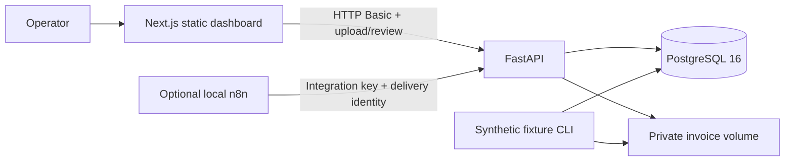
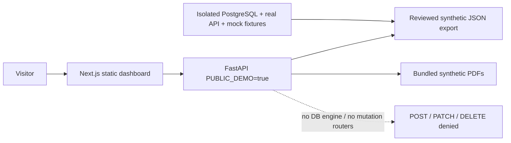
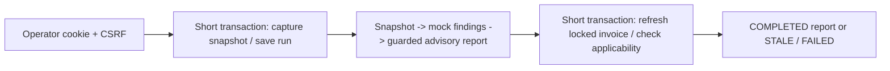

# Architecture and milestone decisions

FastAPI is a modular monolith. PostgreSQL owns application state. Private files
are stored under UUID names on a dedicated local directory/volume. The dashboard
and integrations call the API; no integration owns business rules.

As of Day 5 the writable path below remains the financial authority. Public
portfolio mode is a separate frozen read model over synthetic fixture responses,
not a query onto the private database. See the Day 5 section for that boundary.

Day 1 established ingestion and read APIs. Accepted invoices start `RECEIVED`, with revision 1.
Validation, review and ledger tables establish the schema for later milestones;
their presence does not imply those features work.

- Follow `PROJECT_SPEC.md` for the exact statuses and single demo operator.
  Users and line items do not need separate tables in this MVP: the local
  operator comes from environment variables, and line items belong to versioned
  JSON payloads. This resolves the broader examples in the supplied pasted brief.
  That brief is preserved in `IMPLEMENTATION_BRIEF.md`; its final instruction
  limits the current implementation to Day 1 and requires a results report before Day 2.
- SHA-256 is globally unique: uploading the same bytes from another source returns
  the existing invoice. A PostgreSQL transaction advisory lock serializes equal
  hashes; a unique constraint provides an independent database guard. Duplicate
  attempts append audit events. Business duplicates with different bytes are a
  separate Day 2 validation rule.
- Uploaded filename is display metadata only. Storage uses UUIDs, validates the
  path is under the configured root, and exposes files through an authenticated
  attachment response. No static upload directory is mounted publicly.
- Validate extension, declared MIME, actual signature, and parser acceptance.
  Reject encrypted PDFs, more than 100 PDF pages, and images over 25 megapixels.
  These are bounded demo limits, not a malware scanner. No remote URL ingestion.
- Reject files over 8 MiB. The ASGI middleware additionally caps the entire body
  at 8 MiB plus 64 KiB of multipart overhead, including chunked requests.
- File write and database insert are coordinated: normal transaction failures
  remove the newly written file. A process or host crash can leave an orphaned
  file; crash reconciliation is not implemented in Day 1. PostgreSQL is authoritative.
- Audits are append-only in API code and protected against UPDATE/DELETE by a
  database trigger. Database owners can still remove tables or triggers; this is
  not a claim of tamper-proof financial compliance.
- Startup refuses empty/default operator passwords; OpenAPI docs require auth.
  CORS permits the configured localhost frontend only. Basic auth is local-only;
  this milestone does not implement public portfolio mode.
- Initial migration is explicit and independent of mutable ORM metadata. Tests
  compare the migrated schema to the ORM and use isolated random schemas.

Official implementation references:

- [FastAPI file uploads](https://fastapi.tiangolo.com/tutorial/request-files/)
- [FastAPI HTTP Basic](https://fastapi.tiangolo.com/advanced/security/http-basic-auth/)
- [SQLAlchemy 2 PostgreSQL dialect](https://docs.sqlalchemy.org/en/20/dialects/postgresql.html)

## Day 2: extraction and validation

The `Extractor` protocol has deterministic mock and optional Gemini implementations.
The mock matches source bytes by hash against the answer key. The Gemini adapter
uses the official SDK with an explicit fixed-object provider schema: the SDK rejects
arbitrary-map `additionalProperties` in its legacy response-schema path. All numeric
provider fields are strings. A separate strict Pydantic model validates the response
again, rejects unknown actions, floats, non-finite money, and oversized values.
The real SDK request transformation is exercised with an offline HTTP transport;
this is not a live-model accuracy test.

Processing claims an invoice under a row lock and commits `EXTRACTING` plus a
RUNNING attempt. It then releases the transaction for document/model I/O. Another
request observes the running attempt. Completion locks the invoice again and
refreshes cached ORM objects before checking ownership, preventing an expired worker
from overwriting a newer attempt. Explicit retries reclaim an interrupted attempt
after a two-minute lease. No periodic worker or automatic crash recovery exists yet.

Validation completion locks a normalized supplier/invoice fingerprint with a
transaction advisory lock, checks supplier policies and duplicates, records rules,
and stores parsed data with the resulting state in the same transaction. Exact
file deduplication remains enforced independently at ingestion. The migration adds
normalized identity columns, sticky human-review state, and processing-attempt history
without changing existing invoice IDs or file paths. The health endpoint requires
the current migration revision.

Day 2 stops at READY_TO_POST / NEEDS_REVIEW / EXTRACTION_FAILED. Day 3 will implement
corrections, revision-aware review, and transactional posting with fresh validation;
stored rule results alone must never authorize posting. The currency and arithmetic
limits, retry behavior, and live Gemini configuration are documented in the README.

- [Official Google Gen AI SDK](https://github.com/googleapis/python-genai)

## Day 3: reviewed revisions and ledger transactions

Corrections replace only extracted fields, increment the revision, preserve original
extraction, and append a field-level before/after diff. Current validation is cleared;
revalidation and a current human decision are required before a corrected invoice can
post. An approval is bound to both the revision and canonical payload hash, using
the authenticated operator identity. No request can override a failed rule.

Each validation batch has a UUID. The invoice points to its current batch; details
display that batch only, while earlier results and audited run IDs remain available
in storage. Migration `0003_review_ledger` preserves the visible Day 2 batch and adds
review payload hashes and posted ledger snapshots. Existing unbound legacy approvals
cannot authorize posting; the pre-Day 3 application did not create approval rows.

Posting and corrections serialize on the invoice row. Business-key advisory locks
also serialize new normalized identities against processing and posting; corrections
lock both old and new keys in sorted order. Fresh supplier checks use a shared row
lock, preventing a concurrent policy update from changing the checked row before
commit. Duplicate checks examine both active invoice identities and ledger uniqueness.

The ledger insert, invoice transition, validation batch and audit chain commit in a
single transaction. A later audit failure rolls everything back. Same-invoice retries
return the same ledger entry. The database unique constraints remain authoritative;
a uniqueness failure rolls back first and then records a blocked attempt in a separate
transaction. Failed rule checks commit their new results/review state before the API
returns HTTP 409. No extraction/model call occurs during posting.

Ledger records store the posted payload and revision, providing a stable source for
list and CSV output. Review and ledger rows have database UPDATE/DELETE guards just
like audit events. CSV uses standard quoting and apostrophe-prefix formula defenses;
dashboard totals remain separated by currency. This is an internal synthetic ledger,
not an ERP posting or payment.

- [SQLAlchemy transaction management](https://docs.sqlalchemy.org/en/20/orm/session_transaction.html)
- [SQLAlchemy PostgreSQL dialect](https://docs.sqlalchemy.org/en/20/dialects/postgresql.html)

## Day 4: dashboard and intake

The Next.js App Router frontend exports static pages. Runtime invoice IDs use
`/invoices/detail/?id=UUID` so client-side details work on static hosting without
pre-generating arbitrary invoice paths. A protected API file fetch creates a
short-lived blob URL for previews, revoked when the view unmounts. Credentials
stay in tab memory. Browser money values remain decimal strings; FastAPI remains
the sole authority for revision checks, validation, review and ledger writes.

Invoice lists use current-batch issue filters and a batched issue-code query.
Statistics expose current duplicate failures and a short activity list without
audit payloads. Detail history retains the complete protected before/after audit.

Integration intake is a separate router guarded by `X-Integration-Key`; it cannot
call operator actions. A transaction advisory lock on a hashed delivery identity
precedes the file-hash lock. A receipt links that identity to file SHA and invoice
ID, including cases where the file originally came from the dashboard. Receipts
and new invoice metadata commit together; changed bytes under a used key conflict.
Processing happens after that commit using the existing bounded extractor and
attempt ownership logic. Repeated delivery never changes reviewed/terminal data.

n8n is optional local orchestration. The exported workflow validates one attachment,
sends multipart data with bounded retries, then emits a safe result. Gmail and
Telegram nodes are disabled until account credentials are configured. The CLI
fixture smoke exercises the actual exported guard, HTTP and result nodes without
external accounts. It cannot approve or post an invoice.

## Day 5: frozen public read model and measurable baseline

`app.qa` creates random isolated PostgreSQL schemas, drives the real API with mock
fixtures, measures containment/rule outcomes and exports an explicitly synthetic
public read model. No existing application rows or original fixture bytes change.
The public export includes hash-verified bundled sources, not ephemeral uploads.

The public app returns before registering operator/docs/integration routes. Its
ASGI guard denies mutations before consuming request bytes, regardless of supplied
credentials, and public startup rejects a live extraction mode. Display controls
derive from `/api/v1/config`; frontend hiding is not an authorization boundary.
Anonymous reads are finite and scoped to the committed dataset. Ledger posting,
approval hashes, business locks and all private transitions remain unchanged.

Tradeoff: the public snapshot is intentionally stale relative to a private ledger.
Updating it is an explicit export/review/redeploy operation. It survives sleeping
free hosts without persisting confidential uploads. Neon is optional for a future
private cloud database, not required merely to serve this portfolio projection.

## Phase 2 Day 6: advisory investigation foundation

`modules/investigation` adds a fixed LangGraph sequence:

The graph receives frozen, bounded Pydantic data rather than a database session or
ORM objects. It has no network access or mutation tools. Only recorded
`TOTAL_MISMATCH` expected/observed amounts are explained. Other blockers produce
`INSUFFICIENT` findings. A deterministic guard requires one exact supported output
per snapshot blocker; a model critic is not implemented yet.

Migration `0006_investigation` adds only `investigation_runs`. It stores a minimal
snapshot, input identity, provider/policy versions, requester, status and report.
The request key is unique per invoice; an old key cannot bind to changed input.
This stronger key scope detects conflicts even across validation batches.
Run status is a checked string, separate from the unchanged financial state machine.

POST `/api/v1/invoices/{id}/investigations` accepts an expected revision and
idempotency key. GET `/api/v1/investigations/{id}` rechecks applicability.
Both require the existing operator session; POST requires CSRF. Integration keys
cannot invoke them. The public app registers neither route and still constructs
no database engine. No private report is exposed publicly.

POST returns 202 with an explicit `execution=synchronous_local` marker. In this
milestone the bounded, offline three-node graph completes within the request;
202 is retained for the planned enqueue contract. It is not background execution.
No DB transaction is held while the graph runs. On completion a fresh locked read
checks revision, payload hash, validation batch, document hash and review status.
Stale reports are suppressed on reads; historical stored content is preserved.

LangGraph is pinned to 1.2.22 with resolved dependencies. Its transitive LangSmith
package does not enable tracing: execution explicitly disables it, even if host
tracing environment variables are present. No Gemini extraction changes are needed.
Interrupted RUNNING records have no recovery yet; durable checkpointing and workers
remain Day 12. UI integration is Day 14. See the Day 6 report and learning guide.

## Phase 2 Day 7: validated supervisor and scoped tools

The investigation module now adds a mock supervisor and conditional dispatch loop.
`routing.py` derives required tasks from blocker codes; the proposed plan can
reorder tasks but cannot omit checks, change ownership or introduce tools.
`graph.py` executes financial and supplier roles sequentially, merges by stable
rule/task IDs and checks every finding against captured evidence. The report still
requests evidence; it cannot approve, correct or post anything.

`lookups.py` captures bounded exact SQL evidence under server-derived invoice and
normalized supplier identity. It filters duplicates by supplier plus invoice number
and history by supplier plus currency. `tools.py` exposes five explicit operations
over that frozen projection, with strict schemas and scope checks. Neither provider
nor tool receives a Session, arbitrary SQL, filesystem path or network client.
Distinct reads are cached per run and bounded to 12 calls (five currently available).

Snapshots now optionally include supplier policy, up to 20 active duplicate
candidates, up to 20 matching ledger facts and up to 20 recent same-currency ledger
facts. Truncation is explicit. Finalization and GET compare this evidence as well as
the original revision/hash/batch/source guards. Capturing the whole small read set
is intentionally conservative: changes to even an unused captured source may stale
a report. These checks are advisory freshness safeguards, not transactionally
serializable financial authority; the existing posting transaction remains separate.

Plans, used tool names and a lookup digest are additive report fields. Day 6 records
without them remain readable, with their original evidence semantics. No migration,
new dependency, financial-schema change, public route or frontend integration is
introduced. LangGraph/provider tracing stays disabled and investigation mode is
still scripted mock. Parallel execution and a synthetic PO/receipt/email corpus
remain Day 8; advanced retrieval remains Day 9.
