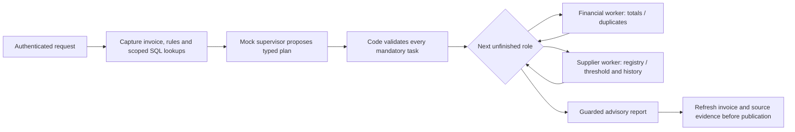

# Day 7: supervisor routing and read-only tool boundaries

Run `.venv/Scripts/python.exe scripts/run_routing_demo.py` with local PostgreSQL
running. Inspect `storage/day-7-synthetic-reports.json`. The four examples are
scripted mock executions in disposable schemas, not live LLM investigations.

## Request flow



The branches are **sequential** in Day 7. A conditional edge chooses the next role
from the validated plan. Parallel fan-out and evidence documents belong to Day 8.

## Important files

| File | Responsibility |
|---|---|
| `backend/app/modules/investigation/routing.py` | Required task/role/tool mapping for the four blocker classes; rejects omissions, duplicates and task changes. |
| `lookups.py` in that module | Captures exact, bounded SQL projections from the server's invoice identity. Never accepts provider-supplied SQL or supplier IDs. |
| `tools.py` | Explicit read-only tool dispatch over frozen data, strict argument and scope checks, no database/session capability. |
| `schemas.py` | New strict plan, task, tool request/result and lookup contracts. Additive report defaults keep Day 6 JSON readable. |
| `providers.py` | Provider Protocol now includes planning and per-task findings; mock templates describe evidence and limitations. |
| `graph.py` | Supervisor node, validated dispatch loop, two roles, deduplicated tools and deterministic report guard. |
| `service.py` | Adds captured lookups to snapshots and freshness checks; preserves existing auth, idempotency and transaction boundaries. |
| `backend/tests/test_investigation_routing.py` | Four routes, malformed plans, scope attacks, missing evidence, bounded reads, stale evidence and financial immutability. |
| `backend/tests/test_investigation.py` | Retains Day 6 safety assertions; adapts internal provider test doubles and the graph step limit. |
| `scripts/run_routing_demo.py` | Four real API examples with mock providers and disposable database schemas. |

## Supervisor versus ordinary routing

The provider's `plan` method is a replaceable planning boundary. Currently the mock
proposes the deterministic mandatory plan. A provider may reorder those tasks,
which changes the order in which the two roles execute. It cannot remove a task,
invent a role/tool, change task ownership, or choose another invoice.

`mandatory_plan` is backend policy; `validate_plan` compares the proposal against
that policy before any worker runs. There is no reason to use an LLM for the
mandatory mapping itself. Additional optional tasks and live planning are not
enabled in this milestone. This is a real LangGraph workflow with mock planning,
not a claim of autonomous AI reasoning.

## Tool schemas and capabilities

`ToolRequest` permits only a tool name and the server-bound invoice/supplier scope.
Unknown fields such as `sql`, `path` or an action are rejected. A request with a
different invoice UUID or normalized supplier key also fails.

The SQL layer first captures a frozen projection. Tools consume that projection,
not a live Session. This sacrifices fetching new information during the graph but
keeps the provider from having arbitrary database access. Source data is checked
again before storing/returning an applicable report. No locks are held while the
graph executes. This is advisory freshness checking, not authority to post.

Exact identity filters precede limits: duplicate candidates match both normalized
supplier and invoice number; ledger history matches supplier and currency. Samples
contain at most 20 rows and carry truncation flags. A sample is not a statistical
baseline or proof of fraud. Source snapshots preserve exact decimal strings.

Tools are cached by name within one invoice snapshot. A combined four-blocker
plan needs five distinct reads; repeated requests for rule/policy evidence reuse
the result. A maximum of 12 distinct tool calls is enforced. No retries or network
model calls are introduced.

## Evidence and old records

Lookup evidence IDs include the captured snapshot digest. The run stores the
bounded source data and report lookup digest. If supplier policy, duplicate
candidates or the captured history changes, the report becomes stale on read;
changed evidence during execution is also checked before publication.

Day 6 snapshots without lookup evidence retain their old semantics. New optional
report fields have defaults, so historical JSON remains readable. No migration,
rewriting of old runs or financial audit modification is needed.

The original document tool reports its hash and explicitly says it did not read
the document. Arithmetic findings cite recorded validation values. They cannot
conclude that an extraction error is definitely a supplier's overstatement.

## Study order and exercise

Read `ROUTES`, `validate_plan`, `ReadOnlyTools.call`, the graph's `next_role` and
worker functions, then `matches` in the service. Compare the valid reordered-plan
test with the skipped-task and wrong-role tests.

Exercise: write a failing test that removes `get_supplier_history` from the
amount-outlier plan. Explain why the supervisor's proposed plan is rejected
before tool execution. Then reverse a valid plan and inspect the graph updates.
Do not add parallel execution or new evidence documents before Day 8 approval.

## Verification commands

From the repository root:

```powershell
.venv/Scripts/python.exe scripts/dev.py test --postgres
.venv/Scripts/python.exe scripts/run_routing_demo.py
.venv/Scripts/python.exe -m ruff check backend/app/modules/investigation backend/tests/test_investigation_routing.py
```

See `docs/day-7-progress.md` for actual counts, failures/fixes and limits.
Official API reference consulted:
https://docs.langchain.com/oss/python/langgraph/graph-api-control-flow
