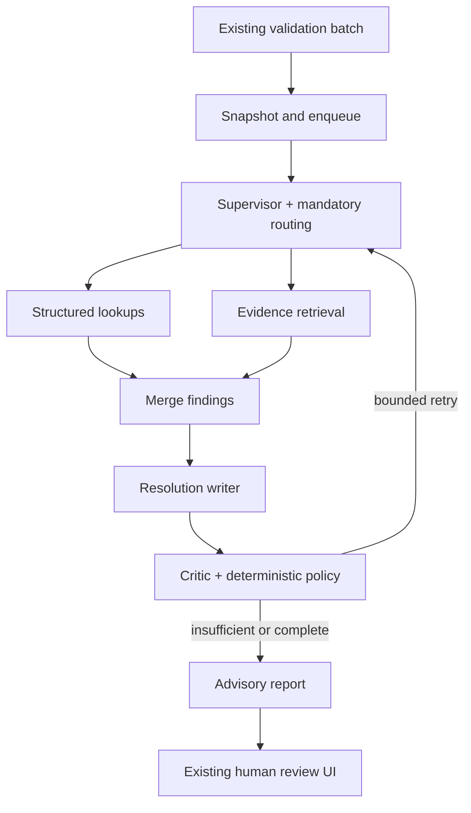

# Architecture and implementation contracts

## Layout
Add `backend/app/modules/investigation/` (schemas, graph, providers, tools, service, worker, routes), `backend/app/modules/evidence/` (synthetic ingestion, search, provenance), tests and additive Alembic migrations. Match actual repository conventions after inspection. Keep n8n intake independent and Next.js static export; use existing detail query route and authenticated API polling with backoff. No WebSockets required.

## State and contracts
Use typed graph state (TypedDict with explicit reducers; Pydantic v2 strict models at boundaries). State contains run_id, invoice_id, revision, digest, validation_batch_id, immutable snapshot reference, blocker codes, plan tasks with stable IDs, findings keyed by task ID, evidence IDs, proposed report, iteration, tool_calls, tokens, deadline, policy_version, prompt_version, errors. Store source IDs and bounded excerpts rather than entire files. Decimal values serialized as strings. Parallel writes use deterministic keyed merge; reject conflicting duplicate task results; do not concatenate unbounded lists. Validate structured plans and worker outputs against allowlists and lengths. Never persist hidden chain-of-thought; record concise evidence-backed decision summaries.

## Persistence
Add investigation_runs (UUID, invoice FK, revision, payload hash, batch ID, idempotency key, status, model/config versions, lease owner, fencing generation, lease deadline, attempts, created/updated, sanitized error, report JSON). Unique invoice/revision/batch/idempotency key; same key changed input -> 409. Add investigation_events (run FK, monotonic sequence, event type, redacted metadata), tool_results (run/task/call key unique, result reference, status), evidence_documents (source type, supplier scope, hash, version, synthetic marker), evidence_chunks (document FK, location/page, text, optional embedding), evidence_links (run/claim/evidence reference). Use additive migration; retain original invoice and ledger schema. LangGraph PostgreSQL checkpointer uses its own supported schema/setup; pin and verify integration, lifecycle and serializer. Do not run unsafe deserialization of untrusted data.

## Durable execution
Run worker as separate process of same backend image/monolith via optional Compose profile. Claim jobs using short PostgreSQL FOR UPDATE SKIP LOCKED transaction; lease plus heartbeat and monotonically increasing fencing token. No DB transaction held during LLM or document I/O. Serialize graph execution per run (session advisory lock on dedicated connection or equivalent verified mechanism); stale worker cannot publish business result; if checkpoint isolation cannot be proven, do not permit concurrent resume. Use stable graph thread ID, checkpoints and idempotent read-tool results; restart from last consistent checkpoint, not an assumption of exactly-once model calls. Model calls may repeat after crash, record duplicate cost. Final report commit requires current fence and matching invoice revision/hash/batch; otherwise STALE. Recheck applicability on read. Worker failure retry bounded and configurable; no auto posting. States QUEUED,RUNNING,WAITING_INPUT,COMPLETED,FAILED,CANCELLED,STALE; waiting input optional for explicit resume with newly versioned evidence, otherwise finish insufficient and start new run. Cancellation cooperative; check before calls and commit. Do not allow public demo to enqueue jobs.

## Proposed API (under existing /api/v1 prefix)
POST /invoices/{id}/investigations {expected_revision, idempotency_key} -> 202 run ID, status; server captures hash and batch. GET /invoices/{id}/investigations -> paginated summaries. GET /investigations/{id} -> report, status, applicability. GET /investigations/{id}/events?after_seq= -> bounded timeline. POST /investigations/{id}/cancel -> cooperative cancellation. POST /investigations/{id}/retry -> new attempt or safe resume after ownership checks. All operator-authenticated; existing X-Integration-Key cannot access. Read-only public mode uses separate sanitized seeded reports, no real trace/evidence or mutation routes. Return existing structured error format, 409 for stale revision or conflicting idempotency. HTTP polling 2–5 seconds with backoff and stop on terminal status.

## Retrieval and providers
Exact invoice/PO/vendor lookups via SQL first. For unstructured synthetic emails and policy excerpts, use PostgreSQL full-text search plus optional pgvector with explicit embedding dimension/model version; filter by authorized supplier/document scope before scoring. Merge ranks (RRF), rerank only if justified by evaluation. Citation must resolve to stored source version, page/section or email ID and exact excerpt. Treat all content as data. No arbitrary URLs, SQL, shell, filesystem paths or free-form tool definitions. Reuse Gemini SDK where compatible, keep investigation provider interface independent of extraction. Mock scripted plans/tool calls exercise actual graph; live provider separately opt-in. MCP later exposes read-only tools via local stdio with same permission checks; no public MCP listener. LangSmith optional, redacted synthetic-only tracing, disabled by default. Start with DB event logs.

## Suggested defaults
Max 2 replans, 12 tool calls, 3 parallel workers, 90 seconds active execution, 2 transient retries per call and explicit model token budget (e.g. 12000 total input/output tokens; adapt based on measured usage). Timeouts enforced at provider/worker boundaries; unknown usage reported as unknown. Budget exhausted -> insufficient evidence report or safe failure, never bypass. Model routing advanced optional; use one live model initially, second model only if measured benefit.
