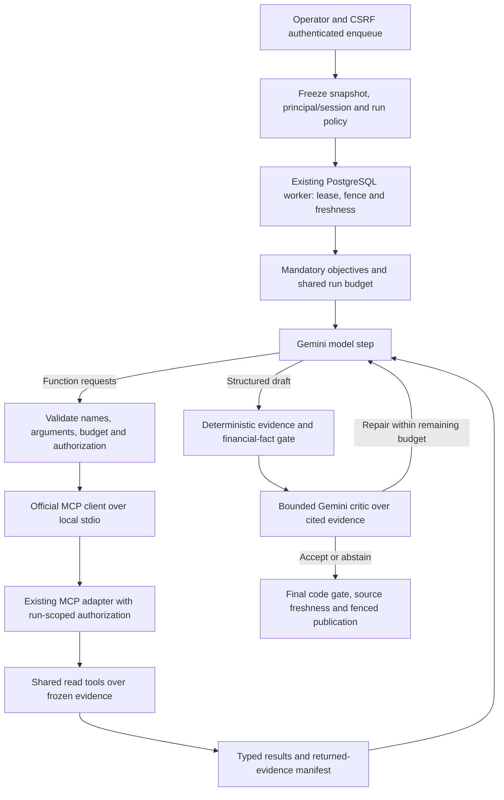

# Day 13 review: live Gemini investigation through MCP

18 November 2026 design; owner authorized Days 13 and 14 on 19 November 2026.
Implementation outcomes belong to the milestone progress reports, not this plan.
Reviewed baseline: `f8b838f`, Days 6–12. This plan supersedes the former optional
live smoke/model-comparison scope of Day 13. It does not mark live investigation
implemented by the original review. That review changed documentation only.
The authorized implementation now adds a separately configurable live provider.

## Objective and boundaries

Implementation refinement: Windows cold import of the MCP child measured 8.55
seconds before database/protocol handshake. The bounded startup allowance is now
20 seconds (configurable 1–30); individual tool calls remain capped at 10 seconds
and the run deadline still governs. This replaces the proposed 10-second startup
default below without increasing financial or tool permissions.

Deliver an opt-in Gemini investigation that chooses authorized tools, obtains
previously unseen evidence through the existing local stdio MCP server, revises
its investigation in response, and produces a grounded advisory report. Retain
scripted mocks as the default for tests/offline work. No financial mutations,
public model execution, new microservice, remote MCP listener, Redis or broker.
Do not alter extraction prompts, deterministic rules, correction, supplier
authorization, approval or ledger posting. A model recommendation grants no action.

## Findings from the actual repository

| Component | Current behavior | Day 13 gap / disposition |
|---|---|---|
| `providers.py` | Protocol has `plan`/`investigate`; only scripted provider exists | Add a separate live interaction boundary; wrapping the existing mock methods is insufficient |
| `routing.py` | Proposed plan must exactly equal mandatory tasks; only order can vary | Retain deterministic mandatory coverage, but separate objectives from the model's dynamic tool sequence |
| `graph.py` | Supervisor pre-executes every planned tool in-process; findings must equal `expected_task_finding` | Keep offline tests; live path must execute model-selected calls via MCP and validate facts, rather than exact canned prose |
| `resolution.py` | Draft summary, findings, gaps and action must equal canonical mock output; default always requests evidence | Retain mock behavior; live generator/critic needs structured assertions, provenance checks and an advisory action allowlist |
| `tools.py` | Rule tool gives blocker count; document/search tools give counts/kinds; invoice tool explicitly has not read original contents | Expose bounded actual rule facts, scoped records and versioned excerpts. Current payloads cannot support document investigation |
| `mcp_adapter.py` | Real stdio JSON-RPC subset; session checked each request; invoice fixed by host; empty arguments | Reuse enforcement/domain tools; add official client interoperability, useful descriptions, run-bound frozen evidence and strict output contracts |
| `OperatorToolHost.call` | Recaptures current snapshot on each call | Would mix evidence revisions with queued immutable snapshot. Run mode must serve the stored snapshot and reject stale applicability |
| `run_mcp_stdio.py` | Standalone host-supplied access token; host DB remap; located outside backend Docker copy | Add an importable in-image module entry point; no copying browser tokens into files or changing container DB host to localhost |
| `service.py` / routes | Enqueue stores actor username, fixed mock mode/version | Bind new live runs to authenticated user/session IDs; never persist access/refresh tokens; configuration stays server-controlled |
| Settings / models / schemas / queue | Mock-only setting/literals/DB constraint and fixed `scripted-durable-v4` claim filter | Add backward-compatible live mode/provider version metadata and additive investigation-only migration; do not rewrite historical mock reports |
| `worker.py` | Good queue/leases/fences/checkpoints; 90s cooperative budget; whole-job transient retries | Reuse durability, add per-call network/process deadlines, persistent run-wide budgets and provider/graph version routing |
| Tool cache / checkpoints | Cache unique per run/tool; closed serializer accepts local contracts | Empty-argument tools can retain cache key. Add call IDs/returned-evidence manifest and bounded local conversation DTOs; no SDK object/pickle persistence |
| Observability | Queue lifecycle/type-only errors; tracing disabled | Add redacted call/usage/latency/termination telemetry; no prompt or reasoning logging |

The LangGraph and worker foundations are sufficient **after these adaptations**;
the existing provider/critic/MCP wiring is not a finished live integration.
Prior 340 backend / 5 browser passes prove the reviewed mock implementation only.
They do not establish live-model quality or official MCP-client compatibility.

## Proposed execution path

Use the existing LangGraph engine with a versioned live execution path: model step,
tool-execution step, draft validation, critic and publication. Checkpoint each
external interaction, rather than hiding an entire tool loop in one graph node.
Reuse queue, reducers/contracts where suitable, controls, provenance and final
publication. Preserve the old mock graph/version so old checkpoints still resume.

Start with **one live investigator session per run**, covering financial, supplier
and document objectives in its bounded plan. Mandatory blocker coverage stays in
code. The model chooses the order and subsequent evidence tools; it cannot waive
a required check. A premature draft is rejected/returned for repair or abstains.
Do not pre-execute all evidence tools and call that dynamic tool use. Retain the
existing parallel mock tests; parallel live role sessions can follow measured need.
This avoids three duplicate contexts, racing shared token budgets and three MCP
subprocesses. No separate LLM supervisor call is needed for routing already in code.

### Gemini and MCP client

Use the configured `GEMINI_MODEL` (currently `gemini-3.1-flash-lite`) and existing
Google Gen AI SDK, with separate investigation settings/prompts/schema/version.
Google documents this model as supporting function calling and structured output.
Validate the installed `google-genai==1.75.0` against the actual account/model before
acceptance; documentation support is not a successful live test. Incompatibility
must fail explicitly, not silently switch models, use a mock or label text as tools.

Add the official Python MCP **client** dependency only after a compatibility/pin
check against Python 3.12 and current dependencies. Current upstream SDK docs use
v2 `Client`; older examples use `ClientSession`/`stdio_client`. Select one verified
release/API, not a mixture. Exercise protocol `2025-11-25` negotiation against our
existing server and handle notifications, generic errors and `isError` responses.
Use no CLI/server framework extra unless needed. Keep the existing server unless
an actual protocol incompatibility justifies a small correction.

Initialize client, list tools, compare names and schemas with the local allowlist,
then translate the approved definitions to Gemini function declarations. Replace
generic descriptions with meaningful domain descriptions. The host explicitly
dispatches validated function requests through `call_tool`, correlates IDs, and
returns typed results to the model. Disable SDK automatic tool execution/retries:
one host loop must own authorization, budgets, telemetry and termination. Do not
also enable the SDK's automatic MCP loop or introduce LangChain tool wrappers.

Use the existing `generate_content` API. Prefer a separate tools-disabled
structured report step after evidence gathering, avoiding dependency on a combined
tools-plus-schema feature. Preserve complete required model content parts and
opaque thought signatures across turns, including IDs. Request no thought text;
do not display, log or persist hidden chain-of-thought. Store only the bounded
protocol history needed to resume, in validated local DTOs; opaque signature bytes
are protocol state, not inspectable reasoning. Exclude optional thought text parts.
Round-trip/signature compatibility must be tested before claiming durable resume.

### Identity, delegation and evidence consistency

Capture `Principal.id` and `Principal.session_id` at enqueue, alongside the
existing username attribution. New live runs require an active OPERATOR session;
legacy runs without this binding remain mock-only. A queued request must not
persist the browser JWT, password, refresh token or CSRF secret.

Proposed worker-to-child delegation: short-lived signed **MCP-only capability**
bound to user ID, existing session ID, run ID, invoice ID, snapshot digest, lease
generation and audience/purpose. It is not a login/access/refresh token and must
be rejected by ordinary authentication endpoints. Mint only after checking the
existing session and current owned run; cap lifetime at five minutes and the
remaining run deadline/session lifetime. Verify signature, purpose, binding,
active user/session, cancellation, fence and freshness before every tool call,
before every model request and before publication. Logout/revocation stops further live work. Retry requires
the original active session; an expired/revoked session needs explicit newly
authorized investigation, not hidden refresh or service-account impersonation.

Deliver the capability through an ephemeral, sanitized subprocess environment
(consistent with the existing launcher); never argv, checkpoint, log, or model
context. Remove it from the child environment after startup. Inherit only needed
runtime variables; never the Gemini API key, refresh credentials, n8n key or other
unrelated secrets. DB credentials and signature verification material are trusted
process secrets. This is application-level read-only enforcement, not an OS sandbox
or a claim that the current application DB role has SQL read-only privileges.
Terminate/wait/kill the owned child on cancellation, timeout and worker exit;
stdin/stdout are MCP-only, stderr must be bounded/redacted. No shell-based launch.

In run mode, MCP loads the host-selected queued snapshot from trusted storage,
verifies its digest and scope, then serves that immutable projection. It must not
recapture new facts into the same report. Existing current-data MCP mode may remain
for standalone authorized use, clearly separate from worker run mode. Check current
applicability before calls and publication using the existing lookup/document and
invoice revision/hash/batch checks. Evidence changes make the run STALE.

Keep the seven current tools; no financial, arbitrary SQL, URL, shell or filesystem
tool. Keep empty arguments initially, preserving a simple run/tool cache key.
`search_evidence` returns the bounded captured SQL/FTS ranking and excerpts, not a
model-selected global search. Dynamic tool selection is real; dynamic free-text
retrieval refinement is out of scope and must not be claimed. Richer parameterized
search would require new scoped schemas and argument-aware cache keys later.

### Evidence and report contracts

The initial model context contains objectives/blocker codes and allowed tools,
not all rule values, supplier facts, supporting texts or expected test answers.
Required facts must arrive through MCP. Extend shared read projections/results
additively with actual bounded structured data: exact recorded rule expected and
observed amounts/currency, relevant extracted fields, supplier registry and policy
facts, duplicate/history samples, and source ID/version/hash/excerpt/offsets.
Preserve Decimal strings, missing/null distinctions and truncation flags. Do not
infer unseen original PDF contents from an extraction record or document hash.
Original-document authenticity/printed-value questions remain unresolved unless
an explicitly implemented bounded evidence source supports them.

Maintain a per-run evidence manifest of **only results actually delivered to the
model**, with call ID, tool, snapshot binding, result hash and typed fact/source
references. Persisted cache delivery still requires an authorized MCP call; cache
hits are visible and distinct from a fresh read. Do not permit direct provider DB
reads or an in-process fallback that bypasses MCP for live evidence.

Report contains summary; findings (claim, status, evidence references, typed factual
assertions); an allowed advisory resolution and rationale; unresolved uncertainties
and missing evidence; scope/truncation limitations; source bindings; provider,
model and prompt/policy versions; mode `gemini`; `advisory_only=true`. Preserve
existing report fields, add bounded fields as needed and keep old mock reports
readable. Do not fabricate confidence scores or invent fields for missing data.

Programmatic gate validates Pydantic schemas, action allowlist, mandatory coverage,
delivered-reference membership, source version/hash/exact excerpt, field paths,
currencies, exact Decimal values and explicitly supported arithmetic derivations.
Do not attempt to prove arbitrary prose by a simplistic number regex. Require
financial assertions in typed form and render factual financial statements from
those validated assertions; prohibit new unsupported numeric claims in prose.
Reject certainty/authorization claims that evidence cannot establish. Unverifiable
causal explanations are labeled hypotheses with uncertainty, never facts.

The Gemini critic gets only draft and cited evidence, no tools or financial action
authority. It checks semantic support/contradictions and can reject or request
repair; it cannot override a code rejection. Maximum two repairs within the same
run budget. Exact canned mock prose is not a live validation rule. Citation
existence and an LLM critic do not prove truth or authenticity; semantic entailment
is partly probabilistic and remains a human-review concern. Final code gate runs
after critic/repairs. Exhaustion returns a clearly labeled abstention/insufficient
report from validated facts, or a safe typed failure; never present a fabricated
successful live investigation or silently substitute mock content.

## Execution limits and telemetry (proposed defaults)

| Limit | Proposed policy |
|---|---|
| Logical model steps | At most 8 across investigation, report, critic and repairs |
| HTTP attempts | At most 12 for the entire run; each logical call at most 3 attempts |
| Tool requests | At most 12, including repeats/denials; dispatch serially initially |
| Repair attempts | At most 2 after initial draft, consuming ordinary step/call budgets |
| Active wall time | 180 seconds across attempts/resumes, including I/O and backoff; increase from mock's 90 explicitly |
| Gemini timeout | At most 60 seconds, clipped to remaining run time; SDK uses milliseconds |
| MCP startup/request | 10 seconds each, clipped to remaining run time; bounded process teardown |
| Token allowance | 24,000 cumulative input/output/thinking tokens across all attempts; preflight/reserve before each request; at most 2,048 output tokens per request |
| Transient retry | 429/selected 5xx and transport failures only, exponential jittered 1s/2s waits, respect Retry-After within remaining deadline |
| Termination | Structured validated report, insufficient evidence, mandatory coverage failure, repeated/no-progress tool loop, auth revocation, cancellation, stale source, malformed/truncated/blocked response, deadline or budget exhaustion |

Values are reviewable starting defaults, not measured performance or spend claims.
Track documented provider usage fields without double-counting thinking/cache
tokens; include retransmitted input every turn. Reserve conservative input plus
maximum output before sending, using actual token counting where supported. Do
not issue a request without enough allowance. Unknown usage/ambiguous timeout
remains unknown, retains conservative reservation and must not reset spending.
Bounded counts/output/deadlines limit exposure but cannot promise an exact provider
billing cap under unknown usage. Dollar estimates require dated pricing input.

Persist a fenced run-wide call/budget ledger independently of graph rollback and
attempt counters. Store model-call intent/reservation before network I/O; reconcile
usage afterward. Crash/lease loss may leave an ambiguous billed request; reserve
it and report ambiguity, not exactly-once execution. Retries and manual resume
cannot reset counters/deadline. Distinguish network retry, writer repair and worker
recovery. Turn off SDK retries; worker restarts use remaining budget rather than
replaying an exhausted call with a fresh allowance. Reuse successful checkpoints.

Record run/step/call correlation IDs, model and SDK/prompt/policy versions, attempt,
finish/block reason, sanitized error class, latency, token categories/unknowns,
tool name/argument digest/result hash, MCP/cache status and termination reason.
No raw prompts, tool text, response bodies, exception strings, credentials or
hidden reasoning in event logs. Keep validated report and minimal private protocol
state separate from operational telemetry. External tracing remains disabled.
Propose 30-day retention for new synthetic protocol/call records via explicit
maintenance; never erase existing financial audits or historical reports.

## Acceptance criteria: proof of actual investigation

All gates must be reported separately as automated, live or NOT RUN. Live smoke
is required for Day 13 completion; lack of permission/key/quota is an explicit
incomplete milestone, not a mock substitute. A plan approval should separately
authorize the bounded paid synthetic smoke; no call is authorized by this review.

1. **Compatibility:** actual configured model accepts declarations and returns a
   function call; official MCP client negotiates/initializes/lists/calls our actual
   stdio subprocess. Structured report and signature/history round-trip pass with
   pinned versions. Provider/model IDs in metadata are authoritative.
2. **Causal live evidence:** seed an isolated synthetic NEEDS_REVIEW invoice with a
   fresh random evidence marker and amended PO/email fact absent from initial
   prompt, source code, mock templates and answer labels. Gemini calls at least
   two distinct evidence tools through actual MCP, across at least two model
   turns separated by results. At least one subsequent tool request follows an
   earlier result; the final report cites the delivered versioned source and
   correctly uses the withheld fact. Merely emitting tool-looking JSON fails.
3. **Counterfactual:** create a second isolated run with the same invoice values
   and initial blocker context, changing only one supporting evidence fact (e.g.
   amendment present vs absent/contradictory). Relevant report conclusion or
   uncertainty changes appropriately, with the correct new citation; no answer
   is prefilled. Trace proves evidence crossed MCP in both runs. Report all
   attempts/failures without cherry-picking a successful stochastic output.
4. **No bypass:** automated test forbids provider direct DB/in-process evidence
   access; severing MCP yields a typed failure/insufficient result, never the same
   completed evidence-backed report. Tool selection is generated by the model;
   host enforces required coverage rather than substituting every call itself.
5. **Grounding:** reject fabricated/not-delivered/cross-invoice/wrong-version IDs,
   changed excerpts, invalid Decimal/currency assertions, omitted required checks,
   unsafe actions and invalid schema. Contradictory/missing evidence is explicit.
   Add human review of live semantic claims; do not equate citations with truth.
6. **Security:** malicious PO/email cannot change scope or gain tools. Test
   unknown/extra arguments, invalid capability purpose/audience, expired/revoked
   session, inactive user, public/integration denial, cancellation and stale fence.
   Logout during a model call prevents its next tool call and final publication.
7. **Reliability:** real PostgreSQL/stdio tests cover child crash/hang, tool error,
   429/5xx/connection/read/write/pool timeout, empty/truncated/blocked output,
   malformed JSON, signature/history recovery, worker kill/resume, late worker,
   cumulative budgets across resumes, and subprocess cleanup without orphaning.
   Simulated Gemini responses use real MCP and DB; separate these from paid tests.
8. **Financial invariants:** before/after snapshots of invoice fields/status,
   supplier authorization, validation records, approvals and ledger remain exactly
   unchanged in investigation scenarios. Only advisory run/evidence-test metadata
   changes. No tool exposes posting/correction/approval.
9. **Regression and honesty:** rerun the existing backend PostgreSQL suite,
   frontend typecheck and existing private/public browser acceptance tests. Report
   actual counts/exits/skips; 340/5 is a prior baseline, not a promised new count.
   Live transcript evidence is sanitized metadata plus controlled synthetic
   references, latency/tokens/failures, never a key or hidden reasoning. No claimed
   quality percentage from one smoke pair; full comparative evaluation is Day 15.

## Implementation order after approval

1. Reverify baseline and installed SDK APIs. Lock supported MCP client/model
   compatibility and synthetic smoke limits before live execution.
2. Add additive investigation mode/session/version/budget/call metadata migration
   and strict live contracts. Keep old mock records/checkpoints readable; unknown
   graph versions fail safely. Rollback refuses incompatible live data rather
   than deleting/coercing it. No financial schema or business-rule changes.
3. Enrich shared frozen read tools and delivered-evidence validation; add run-bound
   MCP authorization and in-image stdio launcher. Test with official client first.
4. Implement Gemini manual function loop, signature-safe protocol DTOs, budgets,
   provider timeouts, redacted telemetry and process cleanup. Wire versioned
   LangGraph model/tool checkpoints and worker recovery; retain mock default.
5. Implement live writer/critic and deterministic assertion/evidence gate. Test
   missing/contradictory/adversarial facts and safe termination with fake Gemini
   transport, actual MCP subprocess and isolated PostgreSQL.
6. Run authorized synthetic live paired smoke and all regression gates, fix actual
   failures, then produce results/learning guide. Stop before Day 14. Containers,
   default live activation and remote push require explicit scope at that time.

Candidate new modules: live provider, MCP client/launcher, live contracts/policy,
budget/telemetry helpers and tests within existing investigation module. Names
are proposals until implementation; do not scaffold separate services/frameworks.

## Trade-offs and remaining roadmap

MCP adds a subprocess, authorization delegation and protocol lifecycle even though
the tools are in the same codebase. It is justified here by the explicit learning
and interoperable-tool objective, not necessary for financial calculations. Keep
one shared tool implementation; protocol conversion must not duplicate business
logic. One Gemini model for investigation and critic simplifies operations but
has correlated blind spots and does not provide independent verification.

Day 13 now includes minimum injection/failure tests and call observability needed
to enable live execution safely. Day 14 still owns UI integration and broader
security hardening; Day 15 owns held-out/comparative evaluations and advanced
observability; Day 16 owns packaging and learning review. Second model, embeddings,
reranker, remote MCP and parallel live role agents are not prerequisites. Current
SQL/FTS retrieval remains lexical and bounded; do not relabel it semantic RAG.

## References checked for this review

Gemini/model and MCP pages inspected 18 November 2026; the LangGraph link is a
reference for implementation verification. Current documentation can be newer
than installed packages; runtime compatibility remains an acceptance gate.

- [Configured model capabilities](https://aistudio.google.com/docs/models/gemini-3.1-flash-lite): function calling and structured outputs supported.
- [Gemini generateContent function calling](https://aistudio.google.com/docs/function-calling?generate-content=true): host execution, responses, MCP, automatic-call controls and multi-turn signatures.
- [Gemini thought signatures](https://aistudio.google.com/docs/thought-signatures?generate-content=true): preserve opaque protocol signatures with original parts.
- [Official Python MCP SDK](https://github.com/modelcontextprotocol/python-sdk): client/subprocess support; current v2 API differs from older session examples.
- [LangGraph durable execution](https://docs.langchain.com/oss/python/langgraph/durable-execution): reverify pinned runtime execution boundaries during implementation.
